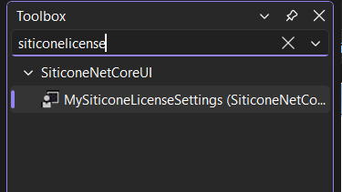
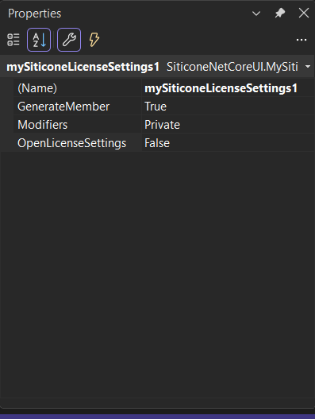
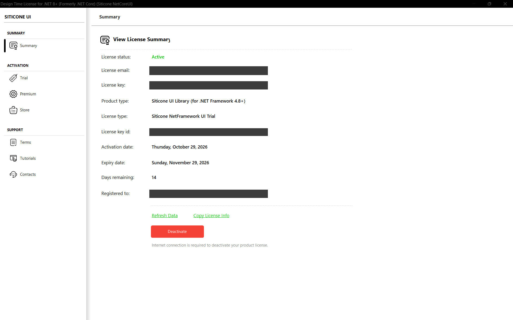

# MediCord

A digital health management system built with **C# Windows Forms (.NET)** and **SQL Server Express**.
Patients book appointments and keep their medical records online, while clinics and hospitals manage appointments, doctors and records from a desktop dashboard.

UTP · FCT0025 Visual Programming

## Supported SDGs

| SDG                                                | How MediCord helps                                                                                                                                                                                          |
| -------------------------------------------------- | ----------------------------------------------------------------------------------------------------------------------------------------------------------------------------------------------------------- |
| **SDG 3: Good Health and Well-being**              | Patients view their medical results and check-up history digitally. This removes unnecessary trips to the clinic just to collect lab results, shortens waiting times and reduces crowding in waiting rooms. |
| **SDG 12: Responsible Consumption and Production** | MediCord replaces paper records and physical appointment cards with one digital system. Going paperless cuts paper waste and stops important medical documents from being lost or damaged.                  |

## Features

**Patients (mobile-style interface)**

- Register, log in and edit profile details
- Find nearby health facilities, sorted by same city, then same state, and search by name, city or state
- View facility details: photo, category, opening hours, location and description
- Book appointments and see upcoming and past appointments with their status (Pending, Approved, Completed, Cancelled, Rejected)
- View and download medical records (PDF), including lab results and prescriptions
- **Dependents:** a guardian can add children, seniors or OKU family members, switch to their profile, and manage their appointments and records

**Facility admin and health workers (desktop interface)**

- Approve, decline, complete, cancel and reassign appointments
- Add health workers and set their working days (with a check for already approved appointments)
- Set facility details, opening hours and closed dates (with a check for existing appointments)
- Upload and manage patient medical records

## Tech stack

|               |                                             |
| ------------- | ------------------------------------------- |
| Language / UI | C#, Windows Forms (.NET 8 or later)         |
| Database      | SQL Server Express, database `MedicordV1`   |
| Data access   | `Microsoft.Data.SqlClient`                  |
| UI controls   | `Siticone.NetCore.UI`                       |
| PDF viewer    | `Microsoft.Web.WebView2`                    |
| Configuration | `System.Configuration.ConfigurationManager` |

All packages are restored automatically from NuGet on the first build, so an internet connection is needed once.

## Requirements

- Windows 10 or 11
- Visual Studio 2022 or later with the **.NET desktop development** workload
- SQL Server Express (instance `.\SQLEXPRESS`) and SQL Server Management Studio (SSMS)
- Microsoft Edge WebView2 Runtime (already included in Windows 11 and recent Windows 10)

## Activate the Siticone UI free trial (one-time, about 2 minutes)

MediCord's buttons, text boxes, dropdowns and cards come from the **Siticone UI** library. It is free to try for **30 days**, but each computer must be registered once. **Without this step the project still opens, but Visual Studio will show a licence warning and the controls may show a trial watermark or fail to render in the designer.**

You only need to do this in Visual Studio (the designer), not every time you run the app.

1. **Restore the NuGet packages.** Open `medicord_v1.sln`, right-click the solution and choose **Restore NuGet Packages**. Wait until it finishes. This downloads `Siticone.NetCore.UI`.
2. **Open any form in the designer.** In Solution Explorer, double-click a form or screen (for example `LoginForm.cs`) so the design view with the **Toolbox** panel opens. If the Toolbox is hidden, go to _View → Toolbox_.
3. **Find the licence tool.** Type `siticonelicense` in the Toolbox search box. You will see **MySiticoneLicenseSettings**.

   

4. **Add it to the form.** Double-click **MySiticoneLicenseSettings** (or drag it onto the form). A small component called `mySiticoneLicenseSettings1` appears in the grey tray under the form. Click it once.
5. **Turn on the licence window.** In the **Properties** panel (View → Properties Window), find **OpenLicenseSettings** and change it from `False` to `True`.

   

6. **Register for the free trial.** A **Design Time License** window opens. Click **Trial** in the left menu, enter your name and email, and follow the steps (an internet connection is needed). When it succeeds, the **Summary** page shows **License status: Active** and the days remaining.

   

7. **Remove the helper from the form.** Delete `mySiticoneLicenseSettings1` from the tray so you do not commit it by accident, then rebuild with **Ctrl + Shift + B**. If the form still shows the old state, close and reopen the designer tab.

**Tips**

- The trial lasts 30 days from activation. If it has expired, use a different email for a new trial, or use the library's Premium/Store options.
- If the window does not open, make sure the form's design view is active, then toggle **OpenLicenseSettings** back to `False` and again to `True`.
- If the build or designer fails right after restoring, close and reopen Visual Studio once, then rebuild.

## Setup

1. **Create the database**
   - Open SSMS and connect to `.\SQLEXPRESS`.
   - Open `Database/MedicordV1.sql` (schema, views and demo data) and click **Execute**.
2. **Open the project**
   - Open `medicord_v1.sln` in Visual Studio.
   - Right-click the solution and choose **Restore NuGet Packages** (this also happens on build).
   - Activate the Siticone free trial (see the section above).
3. **Check the connection string**
   - It is in `App.config`. If your SQL Server instance has a different name, change `.\SQLEXPRESS` to match.
4. Press **F5** to run.

## Demo accounts

Password for every demo account: `Medicord@123`

| Role                   | Email                        | Notes                                                                  |
| ---------------------- | ---------------------------- | ---------------------------------------------------------------------- |
| Patient                | `patient01@medicord.test`    | Has 3 dependents (child, senior, OKU) and appointments in every status |
| Facility admin         | `admin.ipoh@medicord.test`   | Klinik Seri Kinta, Ipoh, Perak                                         |
| Health worker (doctor) | `doctor1.ipoh@medicord.test` | Klinik Seri Kinta, Ipoh, Perak                                         |

More accounts follow the same pattern:

- Patients: `patient02` to `patient36` at `@medicord.test`
- Admins: `admin.ipoh2`, `admin.kl`, `admin.penang`, `admin.jb`, `admin.kk`
- Doctors: `doctor1` to `doctor5`, plus the facility suffix, for example `doctor3.kl`

Dependents have no login. Log in as their guardian and use the profile chip on the home screen to switch profile.

## Demo facilities

| Facility                 | City          | State                            |
| ------------------------ | ------------- | -------------------------------- |
| Klinik Seri Kinta        | Ipoh          | Perak                            |
| Hospital Lembah Kinta    | Ipoh          | Perak                            |
| Klinik Bangsar Sihat     | Kuala Lumpur  | Wilayah Persekutuan Kuala Lumpur |
| Klinik Gurney Wellness   | George Town   | Pulau Pinang                     |
| Hospital Teratai Johor   | Johor Bahru   | Johor                            |
| Klinik Kinabalu Prihatin | Kota Kinabalu | Sabah                            |

All facility names, people and records are fictional demo data.

## Project structure

```
medicord_v1/
├─ Screens/Patient     Mobile-style patient screens (home, appointments, records, dependents, nearby facilities)
├─ Screens/Desktop     Facility admin screens (appointments, settings, workers)
├─ Screens/Worker      Worker dialogs (assign / reassign doctor, work days)
├─ Services/           Database access and business rules
└─ Helpers/            Theme, navigation, message boxes, shared UI helpers
```

## Team

Made for `OMC September 2026`
